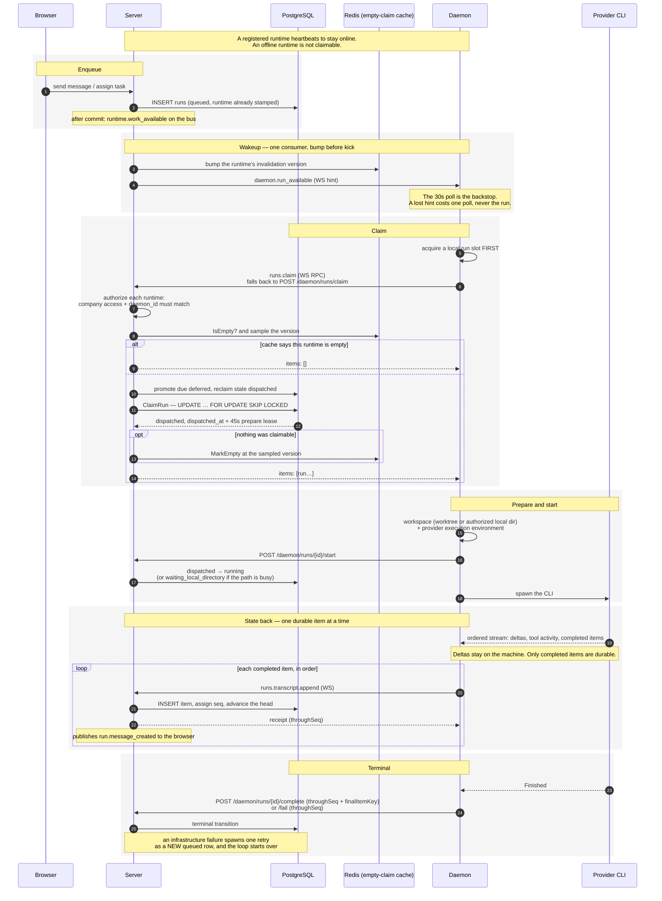

# Zenith Team Architecture

Zenith Team is a cloud-first workspace where a founder runs a company of
persistent AI **Agents**. The Go server owns PostgreSQL-backed product state and the
HTTP/WebSocket contracts. A machine-side **daemon** runs the actual agent
work: it registers the provider CLIs it finds, claims queued runs, prepares a
workspace, discovers an exact runtime's models, Connectors, and Plugins,
launches Codex or Claude Code, and streams results back. It publishes only
sanitized Runtime-scoped capability projections; provider credentials and
provider-native configuration never leave the user's machine.

```text
                    ┌─ PostgreSQL   (all structured product state)
browser ──┐         │
          ├─ HTTP + WebSocket ─ Go/Gin server ─┼─ object storage (file bytes)
desktop ──┘                     │              │
                                │              └─ Redis (realtime relay,
                                │                        claim-empty cache,
                                │                        scheduler beat)
                                │
                        daemon (zenith-team CLI) ─ codex | claude
```

## Repository layout

| Path | What |
| --- | --- |
| `server/` | Go module: HTTP API, WebSocket planes, PostgreSQL access, the daemon, embedded migrations |
| `frontend/` | The client tree — Vite web app plus its Electron/Forge desktop packaging |
| `docker/` | Local infra stack (`compose.yml`) and dev env (`dev.env`) |
| `deploy/` | Production manifests, runbook, and environment reference |
| `docs/` | Design vision, vocabulary, and engineering conventions |
| `scripts/` | Local daemon and Desktop debugging guidance |

## The four binaries

All under `server/cmd/`:

| Binary | Role |
| --- | --- |
| `server` | The HTTP/WebSocket API and the composition root |
| `zen` | The user-facing CLI: `auth`, `daemon start/stop/status/logs`, `config`, `agent`, `runtime`, `task`, `run`, `conversation` and the Run-scoped Agent families |
| `mcp` | `zenith-team-mcp`, the stdio MCP server an agent process talks to |
| `migrate` | Standalone migration runner |

## Request path

```text
handler → <Domain>Service → sqlc queries
```

`internal/handler` is the only package that sees Gin. It binds and validates
the request, then calls a domain service — `TaskService`, `CompanyService`,
`ConversationService` and friends, each an interface with a `Default…`
implementation living in its own domain package. Services read and write
through sqlc-generated queries in `server/pkg/db`. There is no repository or
DAO layer in between, and no ORM: the SQL is written by hand and generated
into typed Go.

Transactions use `db.Store.WithinTx`, `db.Store.WithinRawTx`, or the
`execution.Transactor` seam implemented by the same Store. Events are
collected inside the transaction and published only after it commits.

## Run execution

A run is one agent execution. The loop:

1. **Enqueue** — a message, task assignment, Schedule firing, or confirmed
   Task-report batch creates a `runs` row in `queued`, already stamped with
   the runtime that will execute it. A fresh (parentless) Task Run atomically
   advances the Task's execution generation and freezes the new generation on
   the Run.
2. **Claim** — the daemon claims work over its WebSocket (or by polling)
   through a single `UPDATE … FOR UPDATE SKIP LOCKED` statement that opens a
   45-second prepare lease. The same transaction freezes the reviewed
   Connector contract for that exact Runtime onto the Run.
3. **Prepare** — the daemon materializes a workspace (git worktree or an
   authorized local directory) and the provider execution environment: a
   per-run codex home with managed config blocks, or a claude settings file.
   It resolves the frozen Connector contract against local provider state;
   secrets and native configuration remain local.
4. **Execute** — `agent.New(provider, cfg)` returns the provider adapter,
   which spawns the CLI and normalizes it into one ordered stream of
   `ItemDelta`, ephemeral `ToolActivity`, `CompletedItem`, `SessionReady`, and
   exactly one `Finished`.
5. **Commit items** — disposable deltas stay on the machine. The daemon sends
   each completed item individually over `/api/v1/daemon/ws` as
   `runs.transcript.append` and waits for the post-commit receipt before
   consuming the next durable item. PostgreSQL assigns the Run-local `seq`,
   advances the Run's transcript head, and publishes the full `run.message_created`.
6. **Terminal** — the daemon proves the committed transcript head with
   `throughSeq` and (for completion) `finalItemKey`. The
   server derives the Conversation output from the newest stored agent text
   item, then completes or fails the Run. An eligible infrastructure failure
   creates a retry child as a new queued or deferred row; the child inherits
   its parent's Task execution generation, and the Task stays `in_progress`.

### Claiming a run, and reporting its state back

Who calls whom, and over which transport. Claiming and transcript appends ride
the daemon WebSocket; the lifecycle transitions are plain HTTP. The run's own
states are in [docs/api/runs.md](./docs/api/runs.md).



Two invariants the diagram is drawn to show. The cache version is **bumped
before** the daemon is woken, so a claim already in flight cannot write a stale
"empty" verdict over work that now exists. And the daemon takes a local
execution slot **before** it claims, so a claimed run never sits `dispatched`
on a machine with no capacity to run it.

A 30-second sweeper reconciles everything that can go wrong: expired leases,
offline runtimes, stalled runs, and orphans after a daemon restart.

An agent that needs a decision does not park a run. It raises a durable
approval or question with its live Run token, then the current run ends
normally. Ordinarily, a terminal human response reserves a new `human_input`
run; the startup-and-periodic reconciler atomically inserts that run and marks
the continuation receipt delivered. The narrow Proactive Mode exception is a
Company Plan approval raised by the selected active root-Agent Conversation:
the server executes and resolves it inline with no Inbox item or continuation.
See
[`docs/api/approvals.md`](./docs/api/approvals.md).

## Product workflows around Runs

| Module | PostgreSQL authority | Run seam |
| --- | --- | --- |
| Provider capabilities (`internal/agent`) | Latest Runtime-scoped Connector and Plugin discovery, plus Company Connector policy | `execution` asks the Connector module to freeze the reviewed executable contract during claim. An exact selection freezes in full or the Run is cancelled; Plugin state never grants execution. |
| Schedules (`internal/schedule`) | Creator-private one-shot/cron definitions, exact reviewed sources, lifecycle, firing receipts, Asynq beat and PG repair | A Schedule owns one private `schedule` Conversation. Its capacity-exempt Runs never consume Task slots; the worker calls transaction participants in `conversation` and `execution` to materialize, supersede, or invalidate them without creating a Task. |
| Task outcomes (`internal/task`) | Department/milestone/execution routing, Task execution generation, pending done/failed report events, and generation-fenced merge jobs | An exact live Task Run may declare the business outcome `failed`. A person can confirm pending upward reports; Proactive Mode may instead lease a completed Task merge to that Run's daemon and automatically send the resulting upward report through the selected root-Agent Conversation. |
| Company Email (`internal/mailbox`) | One mailbox identity, retained inbound metadata, and Run-bound outbound draft groups with their durable send queue | A live direct or Task Run may create Agent Mail drafts. A person reviews and queues them; the leased worker performs delivery. |

Provider capability refresh is daemon-owned mechanics: local adapters discover
native state, a coalescing worker publishes sanitized replacement snapshots,
and PostgreSQL becomes the synchronized catalogue and policy authority. Plugin
installation remains provider-native. A Plugin may contribute Connector
identities, but only a reviewed Connector tool contract enters a Run.

A Task names the member responsible for it, the Agent that does its work
(or the member again, when they do it themselves), and a closed milestone
type. Only the assignee starts a Run, and it executes on their own binding
of that Agent (ADR 0014); taking a Task that has already run away from its
member is a confirmed handoff that cancels the live work, advances the
execution and workspace generations, and starts again from the project's
main branch on the new member's computer. `failed` is an Agent-declared
business outcome; `error` represents technical Run failure. Both are
server-owned Task states. A Task retry preserves its parent's generation and
is admitted only while that generation still owns an `in_progress` Task with
the same executing Agent and every dependency resolved. A terminal Run
changes the Task only under the same status, generation, and Agent fences:
completion moves it to `in_review`, a technical failure with no eligible
retry moves it to `error`, and cancellation moves it to `cancelled`.

A new user message in an Agent-executed Task Conversation follows Task policy
before it can queue or materialize a Run. `backlog`, `todo`, `in_review`,
`blocked`, `failed`, and `error` resume to `in_progress` when the fresh Run
actually materializes; resuming `failed` supersedes its pending upward failure
report. `in_progress` remains unchanged; `done` and `cancelled` refuse a new
message. Every admitted status still requires all dependencies to be done, and
a queued prompt is checked again at promotion. An exact request-key replay is
resolved first and replays the existing send outcome without reopening the
Task.

Inbound email bodies and attachment bytes remain with the email provider;
PostgreSQL retains the authorized metadata/read projection for 30 days. Agent
Mail content is durable because a person must be able to review, edit, and
queue it after the originating Run ends. Realtime mail events are PII-free
refetch hints rather than content delivery.

## Realtime

Two WebSocket planes, each owning its own types:

- **Client plane** (`internal/realtime`, `/api/v1/ws?company_id=…`) — a
  receive-only socket indexed by authenticated company and user identity. A
  domain event carries no audience: who may see a fact is decided by the
  consumer that delivers it, and `cmd/server/realtime_routing.go` is the one
  list of what reaches a browser. Post-commit `run.message_created` and other relayed
  entity/signal events use the sharded Redis stream across server processes,
  so every eligible connected client can receive completed transcript items.
  The relay retains its local fanout path; API startup requires Redis for the
  scheduler, even with a single replica.
- **Daemon plane** (`internal/daemonws`, `/api/v1/daemon/ws`) — heartbeats,
  wakeups when work becomes claimable, RPC correlation for WS-first claiming,
  and one-at-a-time durable transcript appends.

Desktop can additionally read a capability-authenticated NDJSON preview from
the daemon's loopback listener. This preview is same-machine rendering
scratch: `run.preview.delta` uses `text` or `reasoning` channels and
`run.preview.reset` clears the scratch wholesale. Its bounded queues may
coalesce or drop deltas, it never enters the cloud WebSocket or PostgreSQL,
and a committed `run.message_created` always wins. Web clients therefore render
provider output only as completed items.

Domain services never touch a socket. They publish to the in-process bus
(`internal/events`), and the composition root registers the consumers that
react — `cmd/server/realtime_routing.go` for the browser plane,
`internal/daemonws` for the daemon wakeups. Each domain declares its own
`<domain>.<verb>` names in `internal/<domain>/events.go`; `server/pkg/protocol`
keeps only the daemon control-frame names. See
[ADR 0008](./docs/adr/0008-run-and-activity-history.md), which supersedes the
retired ADR 0006's Activity writer; the typed-topic rules live in the
`server/internal/events` package doc.

## Where to go next

- [`AGENTS.md`](./AGENTS.md) — the engineering rules: domain charters, naming,
  the non-negotiables, and how to add code to a package.
- [`server/CODEMAP.md`](./server/CODEMAP.md) — where each thing lives and how
  to add an endpoint.
- [`docs/`](./docs/README.md) — product vision, vocabulary, and engineering
  conventions.
